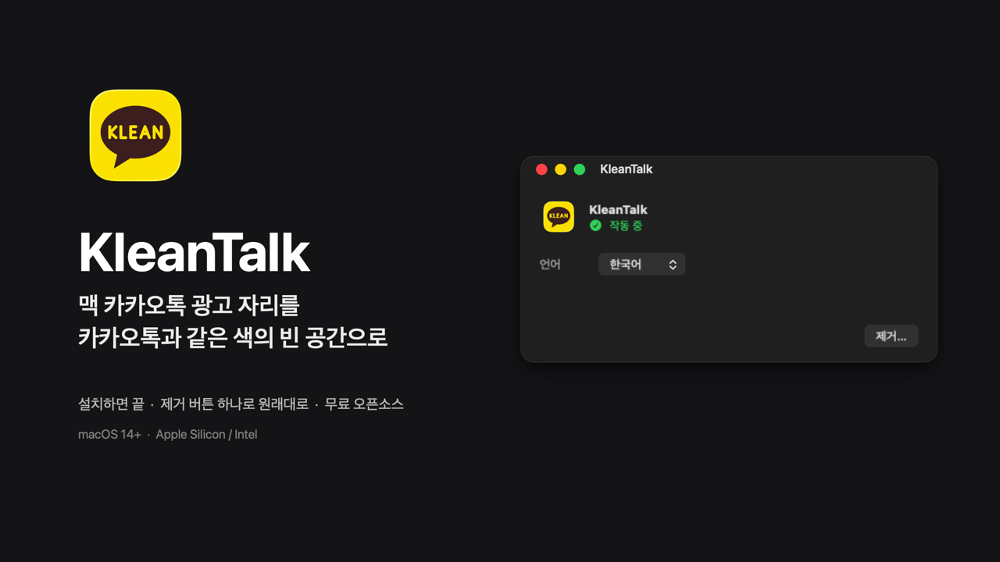
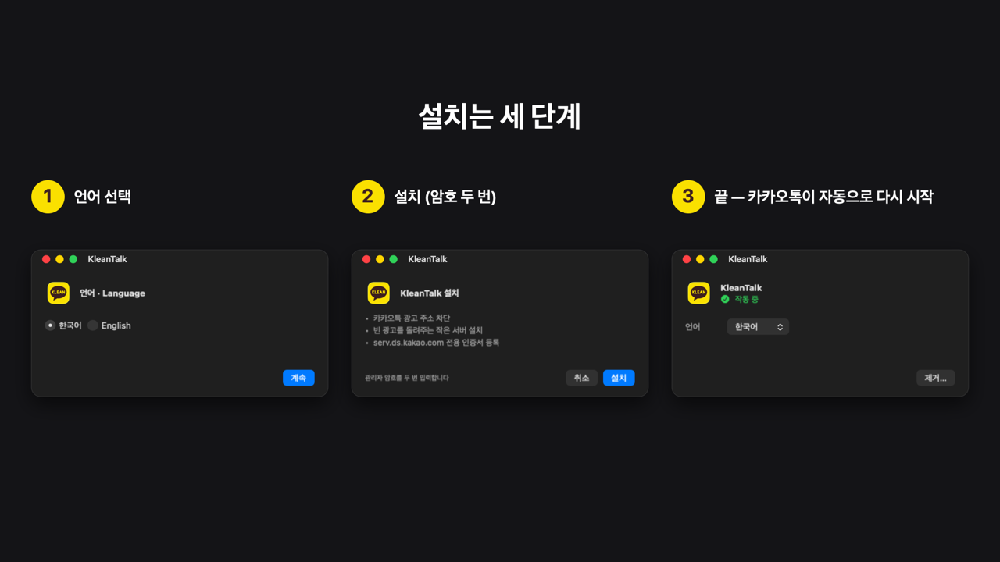
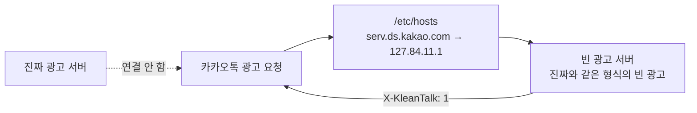
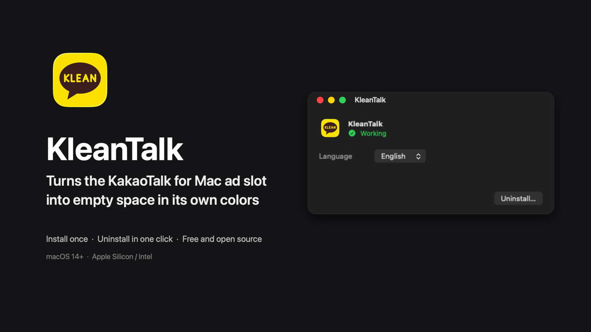
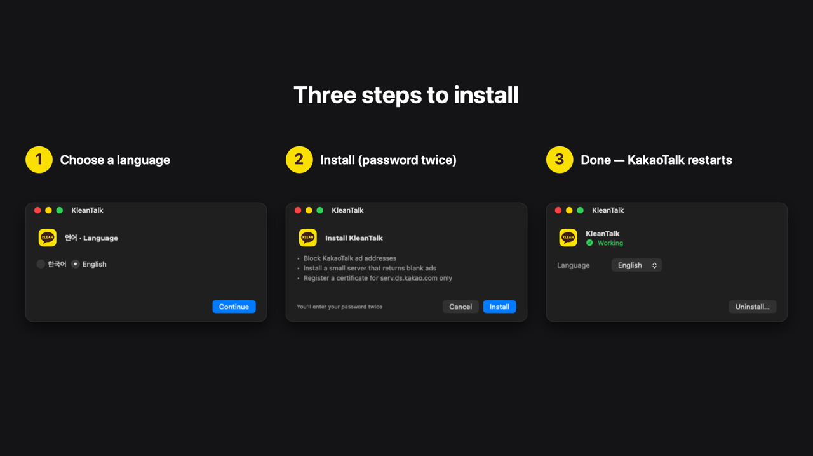

# KleanTalk

[](https://github.com/leejongyoung/KleanTalk/releases/latest)
[](LICENSE)
[](https://github.com/leejongyoung/KleanTalk/releases/latest)

맥 카카오톡 하단 광고 자리를 **카톡과 같은 색의 빈 공간**으로 바꿉니다.
카톡 앱을 고치지 않고, 대화·설정에도 손대지 않습니다.



> 카카오와 관계없는 비공식 개인 프로젝트입니다. 카톡 이용약관과 맞지 않을 수 있으니 확인하고 사용하세요.

- [설치](#설치) · [동작 방식](#어떻게-동작하나요) · [문제 해결](#문제-해결) · [제거](#제거) · [English](#english)

## 설치

**방법 A — Homebrew (권장)**

```sh
brew tap leejongyoung/kleantalk && brew install --cask kleantalk
```

**방법 B — DMG**

1. [KleanTalk.dmg 받기](https://github.com/leejongyoung/KleanTalk/releases/latest/download/KleanTalk.dmg) → `KleanTalk.app`을 `/Applications`에 옮깁니다.
2. 첫 실행에 *"악성 코드가 없음을 확인할 수 없습니다"* 경고가 뜨면 **시스템 설정 → 개인정보 보호 및 보안 → 그래도 열기** 후 다시 실행합니다. (Apple 공증이 없는 개인 앱이라 뜨는 경고입니다.)
3. 언어를 고르고 **설치**를 누릅니다. 암호를 두 번 묻습니다 — 관리자 설치 1번, 인증서 신뢰 확인 1번.



설치가 끝나면 카카오톡이 자동으로 다시 시작되고 광고 자리가 빈 공간으로 바뀝니다.
이후엔 로그인할 때 창 없이 설정만 확인하고, 풀렸을 때만 창을 띄워 **다시 설치**를 권합니다.

> `~/Applications`처럼 사용자 소유 폴더도 되지만, `/Applications`(관리자 소유)이 더 안전합니다.
> 다른 macOS 계정에서도 쓰려면 `/Applications`에 두세요 — 계정마다 첫 로그인 때 신뢰 등록 안내가 뜹니다.

## 어떻게 동작하나요

카카오톡은 광고를 못 받으면 홍보 배너를 대신 띄웁니다. 그래서 막기만 해선 안 되고,
광고 요청을 **성공**시키되 내용만 비웁니다.



1. `/etc/hosts`에서 카카오·다음 광고 주소를 막습니다.
2. `serv.ds.kakao.com`만 이 맥 안의 작은 서버(`127.84.11.1:443`)로 돌립니다.
3. 서버가 카톡 창과 같은 색의 빈 화면을 돌려주고, 카카오톡은 정상 광고로 받아들입니다.
4. 진짜 광고 서버에는 연결하지 않으니 광고 이미지·추적 코드·노출 집계가 오가지 않습니다.

## 이 맥에서 바뀌는 것

| 항목 | 위치 | 내용 |
|---|---|---|
| hosts | `/etc/hosts` | `# >>> KakaoAdBlock` 블록 (광고 차단, `serv.ds.kakao.com` → `127.84.11.1`) |
| 빈 광고 서버 | `/Library/Application Support/KleanTalk/AdServer/` | 실행 파일·인증서·키 (키는 관리자만 읽기 가능) |
| 백그라운드 서비스 | `/Library/LaunchDaemons/com.myungchul.kleantalk.adserver.plist` | 서버 상시 실행 |
| 루프백 주소 | `lo0`의 `127.84.11.1` | 서버 전용 주소 |
| 인증서 신뢰 | 사용자 신뢰 설정 | `serv.ds.kakao.com`의 HTTPS에만 |
| 로그인 시 실행 | `/Library/LaunchAgents/com.myungchul.kleantalk.plist` | 모든 계정 상태 확인용 |

### 보안

- 인증서는 `serv.ds.kakao.com` 전용 일반 인증서(CA 아님). 키가 새도 다른 사이트를 흉내 낼 수 없습니다.
- 키는 root만 읽고, 서버는 443을 연 뒤 `nobody` 권한으로 내려갑니다.
- 전용 루프백 주소라 다른 기기·`127.0.0.1` 개발 도구와 부딪치지 않습니다.
- 설치 패키지의 검역 표시는 설치할 때 자동으로 걷어냅니다.
- hosts는 맥 전체에 적용돼 브라우저의 카카오·다음 광고 주소도 막힙니다. iCloud 등 다른 서비스는 영향 없습니다.

## 문제 해결

| 증상 | 조치 |
|---|---|
| 광고가 다시 뜸 + 상태 "작동하지 않음" | **다시 설치**를 누르세요. |
| 광고가 다시 뜸 + 상태 "작동 중" | 터미널에서 `KleanTalk.app/Contents/MacOS/KleanTalk --diagnose` 실행 → `hosts:` 줄 확인. `serv`가 `ok`가 아니면 hosts 초기화된 것이니 다시 설치. 전부 정상인데 광고가 뜨면 광고 화면 + `--diagnose` 결과를 [이슈](https://github.com/leejongyoung/KleanTalk/issues/new?template=bug_report.md)에 올려 주세요. |
| 다른 계정에서 광고가 뜸 | 계정마다 신뢰 등록 1회 필요. `/Applications`에 있으면 로그인 때 안내가 뜹니다. |
| `kleantalk-adserver` 확인 불가 경고 | 브라우저 DMG의 검역 표시 때문. 1.11.2부터 설치할 때 자동 제거되니 최신 DMG로 **다시 설치**하세요. |
| 원격 연결·다른 앱 문제 | KleanTalk과 무관합니다 (원격 관리·화면 공유·방화벽을 건드리지 않음). |

## 제거

KleanTalk을 열고 **제거…**를 누릅니다. 서버·인증서 신뢰·hosts·로그인 항목을 모두 되돌리고 앱을 휴지통으로 옮깁니다.

## 버그 신고

메뉴의 **버그 신고…**를 누르면 앱 버전·macOS·칩·카톡 버전·상태가 미리 채워진 이슈 화면이 열립니다.
열기 전에 본문을 확인·편집할 수 있고, 홈 디렉터리 경로는 `~`로 가려집니다. ([직접 쓰기](https://github.com/leejongyoung/KleanTalk/issues/new?template=bug_report.md), GitHub 계정 필요)

## 요구 사항과 한계

- macOS 12 이상, Apple Silicon·Intel. 카톡 26.9.0에서 확인.
- 카카오가 광고 방식을 바꾸면 동작하지 않을 수 있습니다 (주소·응답 형식·신호 변경 시).
- 빈 광고 색은 다크 모드 실측치, 인증서 기한은 365일입니다.
- 이 fork에는 자동 업데이트가 없습니다. 새 버전은 Releases에서 DMG를 받아 다시 설치하세요. (자세한 사정은 [`FORK.md`](FORK.md))

## 소스에서 빌드

```sh
./build.sh                # build/KleanTalk.app (Xcode 필요)
./build.sh --install      # ~/Applications에 복사
./scripts/make-dmg.sh     # build/KleanTalk.dmg
```

```sh
sudo ./scripts/install-adserver.sh      # 서버만 설치 (인증서 신뢰는 안내대로 sudo 없이)
sudo ./scripts/uninstall-adserver.sh    # 서버만 제거
```

구조와 설계 이유는 [`docs/DEVELOPMENT.md`](docs/DEVELOPMENT.md)에 있습니다.

## License

[MIT](LICENSE)

---

<details>
<summary><strong>English</strong></summary>



KleanTalk turns the ad slot in KakaoTalk for Mac into **empty space in KakaoTalk's own colors**.
It doesn't patch or re-sign the KakaoTalk app, and doesn't touch your chats or settings.

### Install

```sh
brew tap leejongyoung/kleantalk && brew install --cask kleantalk
```

Or [download KleanTalk.dmg](https://github.com/leejongyoung/KleanTalk/releases/latest/download/KleanTalk.dmg),
move it to `/Applications`, open it (allow **Open Anyway** in System Settings → Privacy & Security),
choose a language and click **Install** (two password prompts: admin install + certificate trust).



### How it works

KakaoTalk shows a promo banner when ads fail to load, so KleanTalk makes ad requests
*succeed* with empty content: ad domains are blocked in `/etc/hosts`,
`serv.ds.kakao.com` points at a tiny local server (`127.84.11.1:443`) that answers
with a well-formed blank ad. Nothing is fetched from the real ad server.

### Uninstall

Click **Uninstall…** in the app. It removes the server, certificate trust, hosts
entries and login item, then moves the app to the Trash.

### Report a bug

Choose **Report a Bug…** in the app menu. The issue opens pre-filled (app version,
macOS, chip, KakaoTalk version, status); review and edit it before it opens.
Home-directory paths are masked as `~`.
([Open directly](https://github.com/leejongyoung/KleanTalk/issues/new?template=bug_report.md), GitHub account needed)

### Troubleshooting

If ads return while status says working, run
`KleanTalk.app/Contents/MacOS/KleanTalk --diagnose` and check the `hosts:` line.
Other macOS accounts need their own one-time trust setup (keep the app in
`/Applications`). Remote management/sharing settings are never touched.
If macOS warns it cannot check `kleantalk-adserver`, reinstall from the latest DMG.

### Security

The certificate is a non-CA leaf for `serv.ds.kakao.com` only. Its key is readable
by root only, and the server drops to `nobody` after binding a dedicated loopback address.

*An unofficial personal project, not affiliated with Kakao. Use at your own risk.*

</details>
